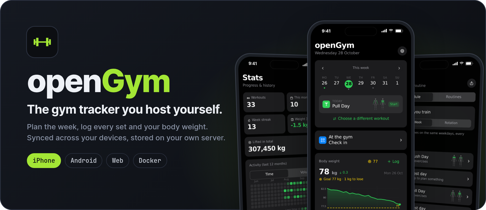

# My Gym — Premium Self-Hosted Fitness Companion

<div align="center">

<p>
  
</p>

[](LICENSE)
[](https://github.com/DuarteSantos8/openGym)
[](docs/design-system.md)
[](#meet-kairo--your-workout-companion)

**My Gym** is a privacy-first, fully-featured fitness tracking and workout planning application designed to run on your own infrastructure. Built upon the robust foundation of [openGym](https://github.com/DuarteSantos8/openGym) (v1.4.5) by Duarte Santos, My Gym features an upgraded design system crafted via **Google Stitch MCP** and introduces **Kairo**, an original reactive SVG workout companion.

[Design System](docs/design-system.md) · [Design Research](docs/design-research.md) · [Licensing & Attribution](docs/licensing-and-attribution.md) · [Self-Hosting Guide](docs/SELF_HOSTING.md)

</div>

---

## Highlights

- **Your Data, Your Machine**: Self-hosted backend with durable local storage. No tracking, no mandatory subscriptions, no third-party telemetry, no cloud lock-in.
- **Google Stitch Redesign**: Obsidian dark aesthetic (`#0D110F`), high-contrast Acid Lime accents (`#C7F36B`), warm amber badges, and crisp typography (`Plus Jakarta Sans` headings paired with `Inter` body text).
- **Meet Kairo**: An original reactive mascot built in pure lightweight vector SVG. Kairo guides you through empty states, celebrates new Personal Records with confetti bursts, holds a stopwatch during rest timers, and cheers your weekly consistency.
- **Offline-First & Fast**: Service-worker powered PWA, instantaneous local state caching via Zustand, and seamless WebAuthn passkey authentication.
- **5,600+ Exercise Catalogue**: Comprehensive library with demonstration media, muscle targeting maps, equipment filters, and custom exercise creation.
- **Ergonomic Active Workout Mode**: Thumb-friendly set completion, plate calculator for standard and specialty bars, automated rest timers, RPE/RIR tracking, and live volume progression.

---

## Meet Kairo — Your Workout Companion

My Gym features **Kairo**, a friendly original mascot dressed in a tech fitness jacket with Acid Lime trim. Kairo reacts dynamically to your training flow:

| Pose | Context & Behavior |
| :--- | :--- |
| **`welcome`** | Greets you on the Home dashboard with session status and motivational insights |
| **`celebrate`** | Bursts out with celebratory confetti when you smash a new Personal Record |
| **`trophy`** | Appears on workout completion summaries with gold championship hardware |
| **`timer`** | Accompanies active rest timers with an amber stopwatch |
| **`focus`** | Keeps you dialed in during high-intensity set entries |
| **`encourage`** | Offers tips in the Exercise Library and Routine editor |
| **`empty`** | Guides you through empty states and starter plan onboarding |

Kairo is rendered entirely in scalable SVG without external raster dependencies, ensuring crisp rendering at any DPI and zero network latency. Kairo fully respects `prefers-reduced-motion` settings.

---

## Core Capabilities

### 1. Planning & Routines
- Multi-day weekly splits (Push/Pull/Legs, Upper/Lower, 5×5, Full Body) or sequential rotations (A/B/C/...).
- Visual muscle targeting heatmap displaying active muscle strain before starting a routine.
- Superset grouping, drop sets, warmup set tagging, rest-pause sets, and timed isometric holds.
- Per-exercise rest intervals, target rep ranges, and planned deload cycles.

### 2. Active Training
- Automatic pre-fill of previous weights and rep counts for streamlined logging.
- Plate math calculator with customizable gym inventories (barbells, plates, machine stacks).
- Screen wake-lock keeps display active throughout your workout.
- Swap unavailable machines instantly with planned backup exercises while preserving progression.

### 3. Progression & Analytics
- Multi-protocol progression rules: Linear, Greyskull LP, Double Progression, and Triple Progression.
- Estimated 1RM calculations with historical trend curves.
- Structural balance ratios (Poliquin, ATG, Thibaudeau).
- Year-long workout activity heatmaps and recovery status visualizations.

### 4. Privacy & Authentication
- Passwordless WebAuthn / Passkey authentication.
- Local JSON file storage with zero cloud dependencies.
- Complete data export/import in JSON and CSV formats.

---

## Quick Start with Docker

The fastest way to deploy My Gym is using Docker Compose:

```bash
# Clone the repository
git clone https://github.com/RahulBongu/my-gym.git
cd my-gym

# Start the stack
docker compose up -d
```

Access the application in your browser at `http://localhost:3000`.

To configure passkeys for a public domain or custom port, edit `.env`:
```ini
RP_ID=your-domain.com
ORIGIN=https://your-domain.com
PORT=3000
DATA_DIR=/data
```

---

## Local Development & Testing

### Prerequisites
- Node.js 20+ (LTS recommended)
- npm 10+

### Setup

```bash
# 1. Install frontend dependencies
npm --prefix frontend install

# 2. Install API dependencies
npm --prefix api install

# 3. Start the API server (runs on :8080)
npm --prefix api run dev

# 4. In a separate terminal, start the Vite frontend (runs on :5173)
npm --prefix frontend run dev
```

### Running Tests

```bash
# Frontend component and unit tests (Vitest)
npm --prefix frontend test

# API integration tests (Node.js native test runner)
npm --prefix api test

# Production build check
npm --prefix frontend run build
```

---

## Architecture & Design System

My Gym follows a decoupled, lightweight client-server architecture:

```
my-gym/
├── frontend/               # React 19 + Vite 8 Single Page App & PWA
│   ├── src/
│   │   ├── components/     # UI components & Kairo mascot
│   │   ├── views/          # Home, Workout, Library, Stats, Settings
│   │   ├── store/          # Zustand reactive state stores
│   │   ├── lib/            # Business logic, math, formatters, WebAuthn
│   │   └── index.css       # Obsidian & Acid Lime design tokens
│   └── public/             # PWA manifests, icons, fonts
├── api/                    # Node.js backend (node:http, zero heavy frameworks)
│   ├── server.js           # Lightweight REST API and static server
│   ├── lib/                # Passkey WebAuthn, session crypto, file store
│   └── test/               # Node test runner test suites
├── docs/                   # Architectural & design documentation
│   ├── design-system.md    # Stitch MCP color tokens, typography & components
│   ├── design-research.md  # Competitive analysis & interaction patterns
│   └── licensing-and-attribution.md # Upstream openGym attribution & media notice
└── docker-compose.yml      # Ready-to-run container configuration
```

For full details on colors, spacing, typography, and Stitch MCP design tokens, see [docs/design-system.md](docs/design-system.md).

---

## Attribution & Licensing

- **Core Application**: Derived from [openGym](https://github.com/DuarteSantos8/openGym) (v1.4.5, commit `2d70e026effc6602f513555166a97443520f0572`), created by Duarte Santos and openGym contributors.
- **License**: [GNU Affero General Public License v3.0 (AGPL-3.0)](LICENSE).
- **Exercise Media**: Exercise illustrations and video demonstrations are provided under their respective open and free fitness media licenses. They are distributed with the application in accordance with non-commercial attribution guidelines.
- **Original Contributions**: The "My Gym" brand identity, Google Stitch MCP design token integration, and Kairo vector mascot are original works released under AGPL-3.0.

*Note: My Gym is an independent fork and redesign and is not officially affiliated with or endorsed by the upstream openGym maintainers.*
